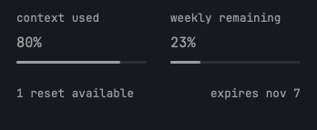

# Session Details for Herdr

A compact, lowercase English-language session panel for **Pi and Claude Code**, with an **experimental Codex CLI adapter**. Model and effort share a line; folder and branch share the next. Context usage, supported subscription limits and reset credits stay quiet and readable.



Close-up of the compact metrics, using the same monospace font as the terminal.

## Support

| Client | Model / effort / context | Weekly allowance | Reset credits |
| --- | --- | --- | --- |
| Pi, any provider | Pi's current session data | Anthropic OAuth and OpenAI Codex OAuth | Codex OAuth only |
| Claude Code | Status-line JSON | When Claude reports `rate_limits.seven_day` | Not shown |
| Codex CLI (experimental) | Session hooks and that session's JSONL metadata | Reported limit, or ChatGPT usage API | ChatGPT OAuth with file-backed credentials |
| API-key / local models | Supported through the clients above | Hidden when unsupported | Hidden |

Unknown is not zero. Fields a client doesn't report remain unknown. This is not a promise to query account quotas from every provider. Gemini CLI and OpenCode are not implemented; their models work through Pi.

## Install

Requires Node.js **22.19+**, Herdr app (tested with **0.1.10**), and `hc` on the agent's PATH (tested with **0.1.15**). Pi was tested with **1.4.0**. Claude must expose the documented status-line JSON fields. Codex must support `SessionStart`, `UserPromptSubmit` and `Stop` command hooks.

Review the code before installing: adapters run local programs, and the optional OAuth integrations call provider usage endpoints.

```sh
git clone https://github.com/filipores/herdr-session-details.git
cd herdr-session-details

# Pick only the clients you use. No arguments installs just the Herdr mod.
node install.mjs pi claude codex
herdr-app do mod.open --name session-details
```

- **Pi:** run `/reload`. The installer adds a small extension entry point; there are no npm runtime dependencies.
- **Claude Code:** restart Claude. Your existing status-line command, stdin and stdout are preserved by a wrapper. The original configuration is stored in `~/.claude/herdr-session-details-statusline.json` and settings backups.
- **Codex:** restart Codex, enable hooks if your version requires it, and approve the newly configured hooks through Codex's normal trust flow. The installer does not bypass hook approval or change TOML feature flags.

An unrelated mod already named `session-details` is not overwritten: review it and explicitly pass `--replace` to back it up and replace it. Installed files and client settings are backed up before replacement. Re-running the installer does not duplicate hooks or wrap Claude's HUD a second time. It honors `HERDR_APP_HOME`, `PI_CODING_AGENT_DIR`, `CLAUDE_CONFIG_DIR` and `CODEX_HOME`. Do not install both the Pi entry point and the package manifest into the same session.

The mod doesn't rearrange your layout. For a sidebar panel, clone your layout first, then place this block where you want it:

```json
{
  "id": "session-details",
  "type": "block",
  "content": { "mod": "session-details" },
  "size": { "px": 210 },
  "min": 160
}
```

Optionally use the same mod with `"props": {"footer": true}` for a plain machine/branch footer without an agent count. Existing `session-details` layout blocks keep working.

For a remote machine, install the relevant adapter there as well. The mod receives terminal metadata through Herdr; it never copies remote credentials onto the viewing machine.

## Data and freshness

Adapters publish a versioned `herdr.session-details` terminal label. Only model, effort, directory, context percentage, client, process identity, optional session ID, quota values and timestamps leave the adapter. The view is provider-neutral and renders explicit capabilities, not model-name guesses. Legacy Pi labels remain readable during upgrades.

- Pi publishes effort selections directly, without waiting for subscription requests. Other session facts refresh every five seconds and on session events; subscription data once a minute. A missing heartbeat expires after 75 seconds.
- Claude refreshes when its status-line callback runs. Codex refreshes on the configured session/turn hooks. Idle native-CLI metadata stays valid only while the same process owns the terminal. Quota tooltips include the report time; elapsed reset/expiry dates never imply an automatic refill.
- Codex reads **only the transcript path provided by its hook**, verifies the session ID and discards conversation content. Context is last-request total tokens / model context window, not accumulated lifetime tokens. This raw fraction can differ from Codex's own baseline-adjusted UI percentage. After compaction it is unknown until reported again.
- Codex session replay is streaming and time-bounded. Very large or unavailable transcripts may leave context/effort unknown. Keychain-only Codex authentication is not read: reset credits then remain unsupported, while transcript metadata still works.
- Read-only OAuth requests go to OpenAI's `/backend-api/wham/usage` and `/rate-limit-reset-credits`, or Anthropic's `/api/oauth/usage`. These endpoints can change. No reset is redeemed or purchased. Native Claude uses its supplied JSON and never reads credentials.

The panel follows Herdr's terminal font. Percentages use muted, normal-weight 14 px text. Display text is lowercase; tooltips retain original case-sensitive paths and branch names. Precise percentages, full paths and local reset/expiry times are available in tooltips. Colors and icons come from Herdr's native theme and shipped `workspace-chrome` assets. No HTML, webview, analytics or terminal-text scraping.

## Verify

From the source checkout:

```sh
npm test
herdr-app check "$HOME/.config/herdr-app/mods/session-details"
herdr-app status
npm pack --dry-run
```

Tests cover native payload normalization, session/process isolation, expired and unsupported quotas, read-only requests, original HUD passthrough, and repeated installation in paths containing spaces and apostrophes.

## Verification and limitations

Verified locally: **25 tests** on Node 22 and 24, native Herdr validation, live Shift+Tab effort changes in Pi, and live startup metadata from Pi (Codex and Anthropic models) and standalone Claude Code. No model requests were sent. Claude's idle session had not reported context or subscription limits; those fields are fixture-tested, not live-verified.

**Codex CLI is experimental:** its transcript and hook contracts are covered by fixtures, but no Codex executable was available for a real end-to-end test.

This mod is distributed through [GitHub](https://github.com/filipores/herdr-session-details), following [Herdr's sharing rules](https://herdr.dev/mods/#share): a public repository with the topic **`herdr-mod`**, root `RECIPE.md` and `preview.png`, and `mods/session-details/`, without a `layouts/` folder. The recipe describes a clean reconstruction. Herdr indexes community mods within the hour and screens their pictures; listing is not a code review or endorsement.

There is no npm release. `private: true` in `package.json` prevents accidental npm publication; it does not make the GitHub repository private.

macOS is the local test platform. Windows, Linux, remote machines, VoiceOver and light appearance still require release QA. The implementation uses portable Node APIs and supports both path separators, but this is not a cross-platform certification.

## Roll back

Select your prior Herdr layout, restore the timestamped mod/extension backups and the original client settings, then reload/restart the affected clients. The installer leaves unrelated hooks and settings intact. Do not delete the saved Claude status-line configuration while its wrapper remains configured.
