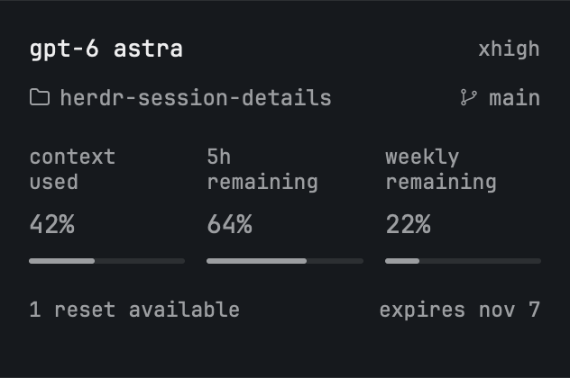

# Session Details

A quiet native Herdr panel that answers: which model is running, where, how full is its context, and what supported subscription allowance remains? It supports Pi, Claude Code and Codex CLI without assuming every model has a Codex subscription.

## What you see

A theme-colored panel about 210 logical pixels high, with 16-pixel padding and the current Herdr terminal font. A 13-pixel regular model name sits beside the smaller raw reasoning-effort label, such as `xhigh`. Folder and branch occupy the next muted line, with Herdr's folder and branch icons.

Below, context used and supported weekly allowance remaining sit side by side. Labels are quiet, percentages are muted, normal-weight whole numbers at 14 pixels, and both three-pixel gauges use the same muted gray. Unsupported allowance fields are omitted. Supported but unavailable values use an em dash.

Where supported, one secondary line gives reset-credit count and the earliest expiry date. There are no decorative cards, extra rules or redundant Live headings. Hover exposes exact values and timestamps, also provided as accessibility labels. Display text is lowercase English. Case-sensitive paths, branches and model IDs keep their original spelling in tooltips.

## How it behaves

The panel follows the focused terminal, not the first agent in a workspace. Switching panes switches the data. Metadata from a different process never applies. Narrow sidebars turn into an icon rail that expands on click. Unknown values never become zero; unavailable capabilities don't produce empty Codex-specific rows.

Pi heartbeats and event callbacks keep the panel current. Native CLI adapters are event-driven; their quota tooltips show report time. Expired reset dates clear affected values pending a fresh report. Background/blocked/done agents don't interrupt the panel or change the normal Herdr agent-state integration.

## Built from

- A `block` whose `content.mod` is `session-details`, placed in a personal layout; optional `props.footer` gives a plain bottom status bar.
- `main.js`: GPUI builders and Herdr's `focused`, `panes`, `terminals`, `spaces`, `theme`, `run` APIs.
- `status.js`: versioned metadata validation, capability selection, freshness and presentation formatting.
- Pi extension: model/context APIs, existing provider authentication, bounded quota polling, `hc label`.
- Claude status-line wrapper: normalizes the supplied JSON and forwards the same stdin to the person's original status-line command, preserving stdout.
- Codex command hooks: verified session-specific JSONL metadata, optional read-only ChatGPT usage calls, and `hc label`. Hooks write no conversational output and never request another turn.
- Shared adapters use Node's standard library, with no runtime package dependencies. Credentials remain in the client's authentication layer; only display metadata is sent to Herdr.

## Watch out

Claude 2.1.316 and Codex 0.166.0 were live-tested through turns, model changes, compaction and resume. Codex's first metadata can arrive only after the first prompt; its `PostCompact` hook provides compaction updates. These checks used OAuth subscriptions on macOS; API-key/local-model cases remain fixture-tested.

Herdr doesn't supply model/effort/context by itself: an adapter must be installed on the machine running the client. Do not infer quota support from a model name. Codex API-key/local-provider sessions must not inherit a different ChatGPT account's quota. Native hook reports are not Pi-style heartbeats. Verify `session_id` against the actual Codex transcript; don't scan for the latest file in a folder. Never publish prompts, replies, credentials or account identifiers.

Read existing client settings before changing them. Preserve Claude's existing HUD and Codex's other hooks, back up originals, quote paths, and keep repeated installation idempotent. Do not bypass Codex hook trust. Shipped Herdr layouts and mods are read-only: clone a layout before inserting the panel.

## Done when

- Pi with an API-key or local model shows model/context without a fake weekly quota or reset row.
- Claude shows its own model, effort, context and reported weekly allowance; its existing HUD still renders.
- Codex hook metadata belongs to the correct session/process and uses last-request context tokens, not lifetime totals.
- Changing the focused terminal never carries another session's data across.
- Expired/unknown values are distinguished from actual zero and unsupported fields are hidden.
- Tests and `herdr-app check` pass; live QA covers the intended client and platform before claiming support is verified.
